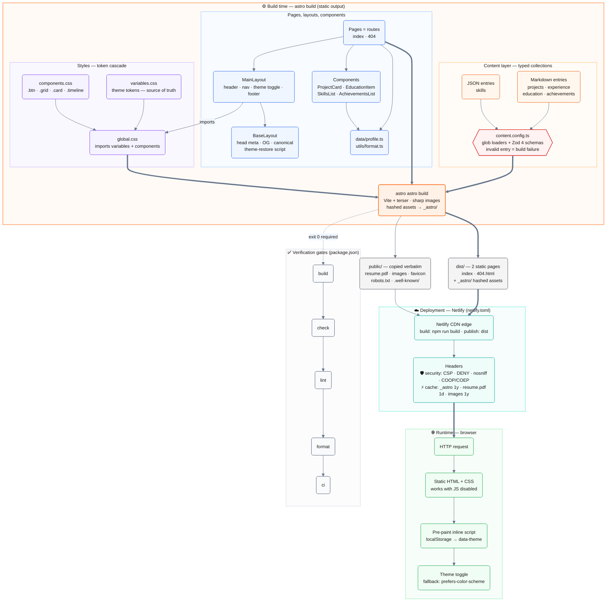

# Astro Portfolio

<div align="center">

---

## 📑 Table of contents

- [✨ Highlights](#-highlights)
- [🚀 Quick start](#-quick-start)
- [📁 Project structure](#-project-structure)
- [🏗 Architecture](#-architecture)
- [🎯 Content-driven — no hardcoded data](#-content-driven--no-hardcoded-data)
- [🎨 Customization guide](#-customization-guide)
- [🌐 Deployment](#-deployment)
- [🔁 CI](#-ci)
- [📚 Docs](#-docs)
- [🛠 Tech stack](#-tech-stack)
- [📊 Performance profile](#-performance-profile)
- [♿ Accessibility checklist](#-accessibility-checklist)
- [📸 Screenshots](#-screenshots)
- [🤝 Contributing](#-contributing)
- [📄 License](#-license)

---

## ✨ Highlights

| Feature                   | Details                                                                             |
| ------------------------- | ----------------------------------------------------------------------------------- |
| ⚡**Performance**         | Static HTML + CSS, no framework or hydration; measured payload table below          |
| 📦**Bundle size**         | Home page: 6.1 KB gzipped HTML + ~9 KB gzipped CSS,**0 bytes** bundled JS           |
| 🎨**Theming**             | Light/dark mode, OS preference + manual toggle persisted in`localStorage`           |
| 📝**Content collections** | Typed Markdown/JSON validated by Zod 4 at build time — bad entry fails the build    |
| 🖼**Images**               | Astro Assets + Sharp: hashed, responsive WebP derivatives in`/_astro/`              |
| 🔍**SEO ready**           | Open Graph, Twitter cards, canonical URLs,`robots.txt`, sitemap-ready config        |
| 🛡**Security**             | CSP + security headers via`netlify.toml` and `public/_headers`                      |
| ♿**Accessibility**       | Semantic HTML, skip link,`:focus-visible`, `prefers-reduced-motion`, WCAG AA colors |

---

## 🚀 Quick start

Requirements: **Node ≥ 22.12** ([nvm](https://github.com/nvm-sh/nvm): `nvm use 22`).

```bash
# Clone & install
git clone https://github.com/NYN-05/astro_portfolio.git
cd astro_portfolio
npm install

# Development — http://localhost:4321
npm run dev

# Production build → dist/
npm run build

# Preview the production build locally
npm run preview
```

Quality gates (all run in CI):

```bash
npm run check    # astro check — TypeScript
npm run lint     # ESLint (Astro + a11y)
npm run format   # Prettier --check
npm run ci       # check + lint + format
```

---

## 📁 Project structure

```text
astro_portfolio/
├── .github/
│   └── workflows/ci.yml    # CI: audit → check → lint → format → build → verify dist
├── Docs/                   # PRD, design rules, CHANGES.md log, architecture.mmd
├── public/                 # Copied verbatim into dist/
│   ├── images/             # Project images (served as-is)
│   ├── resume.pdf          # Downloadable résumé
│   ├── robots.txt          # Sitemap pointer
│   └── _headers            # Security headers (Cloudflare-style hosts)
├── src/
│   ├── components/         # ProjectCard, EducationItem, SkillsList, …
│   ├── content/            # Content collections (source of truth)
│   │   ├── projects/       # Project case studies (Markdown + frontmatter)
│   │   ├── education/      # Academic background
│   │   ├── skills/         # Skill categories (JSON)
│   │   └── achievements/   # Awards, certs, publications, hackathons
│   ├── content.config.ts   # Zod 4 schemas — build-time validation
│   ├── data/profile.ts     # Identity, contact links, socials
│   ├── layouts/            # BaseLayout (head + theme script), MainLayout (chrome)
│   ├── pages/              # Routes: index, 404
│   ├── styles/             # variables.css → global.css → components.css
│   └── utils/              # Helpers (date formatting)
├── astro.config.mjs        # Site URL, static output, images, terser
├── netlify.toml            # Netlify build + security headers + cache rules
└── package.json
```

---

## 🏗 Architecture

Full source of truth: [`Docs/architecture.mmd`](Docs/architecture.mmd) (Mermaid — renders on GitHub and in the VS Code Mermaid extension).



| Stage      | What happens                                                              |
| ---------- | ------------------------------------------------------------------------- |
| ⚙️ Build   | Content + pages + styles →`astro build` → static `dist/`                  |
| ☁️ Deploy  | Netlify serves`dist/` with security headers and cache rules               |
| 🌐 Runtime | Static HTML works JS-off; inline script restores theme before first paint |
| ✅ Gates   | `npm run ci` = astro check + ESLint + Prettier                            |

---

## 🎯 Content-driven — no hardcoded data

All portfolio content lives in **typed content collections** (`src/content/`).

- Add a project → drop a `.md` file in `src/content/projects/`
- Update skills → edit `src/content/skills/*.json`
- Change your name/links → edit `src/data/profile.ts`

**Build-time validation** via Zod schemas catches missing/incorrect fields before deploy.

---

## 🎨 Customization guide

### 1. Personal identity — `src/data/profile.ts`

```ts
export const profile = {
  name: "Your Name",
  tagline: "Your Title — Your Focus",
  focus: "Your specialization summary",
  about: ["Paragraph 1", "Paragraph 2"],
  contact: [
    {
      label: "Email",
      value: "you@example.com",
      href: "mailto:you@example.com",
    },
    {
      label: "GitHub",
      value: "github.com/you",
      href: "https://github.com/you",
    },
    {
      label: "LinkedIn",
      value: "linkedin.com/in/you",
      href: "https://linkedin.com/in/you",
    },
  ],
};
```

### 2. Projects — `src/content/projects/*.md`

```markdown
---
title: "Project Name"
description: "One-line summary"
problem: "What problem it solved"
approach: "How you built it"
technologies: ["Tech1", "Tech2"]
contributions: ["Your specific work"]
results: "Measurable outcome"
repoUrl: "https://github.com/you/repo"
demoUrl: "https://demo.example.com"
status: "completed" | "in-progress" | "archived"
featured: true
startDate: "2024-01"
endDate: "2024-06"
image: "/images/project-screenshot.png"
imageAlt: "Description for accessibility"
---
```

> **Frontmatter tips** (learned the hard way — see `Docs/CHANGES.md`): quote list items that
> contain `:`, and never use `\'` inside single-quoted strings.

### 3. Skills — `src/content/skills/*.json`

```json
{
  "category": "Category Name",
  "summary": "Your philosophy/approach",
  "evidence": "Concrete example from your work",
  "items": ["Tool1", "Tool2", "Tool3"]
}
```

### 4. Site URL — `astro.config.mjs` and `public/robots.txt`

```js
export default defineConfig({
  site: "https://your-domain.com", // REQUIRED for canonical URLs, OG, sitemap
  // ...
});
```

Also update the sitemap URL in `public/robots.txt`.

---

## 🌐 Deployment

### Netlify (recommended)

1. Connect the repo at [app.netlify.com](https://app.netlify.com)
2. Netlify auto-detects `netlify.toml` (build: `npm run build`, publish: `dist`)
3. Add a custom domain → done

Security headers (CSP, `X-Frame-Options`, caching) are defined in `netlify.toml`.

### Vercel / Cloudflare Pages / GitHub Pages

- Framework: **Astro** (auto-detected)
- Build command: `npm run build`
- Output directory: `dist`

> Cloudflare-style hosts also read `public/_headers` (copied into `dist/`) for the same
> security headers.

### Any static host

```bash
npm run build
# Upload the contents of dist/ to your host
```

---

## 🔁 CI

GitHub Actions (`.github/workflows/ci.yml`) runs on every push/PR:

1. `npm audit` — fail on high/critical vulnerabilities
2. `npm run check` — TypeScript / Astro diagnostics
3. `npm run lint` — ESLint (Astro + accessibility rules)
4. `npm run format` — Prettier check
5. `npm run build` — then verifies `dist/` contains the expected pages, `_headers`, `robots.txt`

Dependabot keeps dependencies updated (`.github/dependabot.yml`).

---

## 📚 Docs

| Document                                             | What it contains                                       |
| ---------------------------------------------------- | ------------------------------------------------------ |
| [`Docs/PRD.md`](Docs/PRD.md)                         | Product requirements and scope                         |
| [`Docs/architecture.mmd`](Docs/architecture.mmd)     | Mermaid architecture diagram (source of the one above) |
| [`Docs/ui_design_rules.md`](Docs/ui_design_rules.md) | Visual/design rules the UI must follow                 |
| [`Docs/CHANGES.md`](Docs/CHANGES.md)                 | Mandatory development log — append every change        |
| [`AGENTS.md`](AGENTS.md)                             | Agent/contributor conventions for this repo            |

---

## 🛠 Tech stack

| Layer     | Technology                                                           |
| --------- | -------------------------------------------------------------------- |
| Framework | **Astro 7** (static output)                                          |
| Language  | **TypeScript** (strict)                                              |
| Styling   | **Vanilla CSS** — custom properties, no framework                    |
| Content   | **Astro Content Collections** (Markdown + JSON, Zod 4 schemas)       |
| Images    | **Astro Assets + Sharp** (hashed, responsive derivatives)            |
| Fonts     | **Google Fonts** — Poppins, Libre Baskerville, IBM Plex Mono (async) |
| Icons     | Inline SVG (zero requests)                                           |
| CI/CD     | **GitHub Actions** + **Netlify**                                     |

---

## 📊 Performance profile

Measured from a clean `npm run build` on 2026-10-10 (gzip sizes via GZipStream):

| Asset                | Raw     | Gzipped     |
| -------------------- | ------- | ----------- |
| `/` (home page HTML) | 25.8 KB | **6.1 KB**  |
| `404.html`           | 6.8 KB  | **2.2 KB**  |
| CSS (2 hashed files) | 47.5 KB | **8.7 KB**  |
| Bundled JavaScript   | 0 bytes | **0 bytes** |

Notes:

- The only JavaScript is a small **inline** theme/reduced-motion script in `BaseLayout` — no bundles, no hydration.
- Fonts load asynchronously from Google Fonts (`display=swap`); images are on-demand Sharp derivatives in `_astro/`.

---

## ♿ Accessibility checklist

- [x] Semantic HTML5 structure (`header`, `main`, `section`, `footer`, `nav`, `article`)
- [x] Single `<h1>` per page, logical heading hierarchy
- [x] Skip-to-main-content link
- [x] `:focus-visible` styles on all interactive elements
- [x] `prefers-reduced-motion` respected (animations disabled)
- [x] Color contrast ≥ 4.5:1 (WCAG AA) for body text in both themes
- [x] `alt` text on all images; ARIA labels on icon-only controls
- [x] Keyboard-navigable navigation and theme toggle

---

## 📸 Screenshots

| Homepage                                   | Projects Section | Skills Grid      |
| ------------------------------------------ | ---------------- | ---------------- |
|  | _Add screenshot_ | _Add screenshot_ |

> **Tip:** run `npm run preview` after a build and capture screenshots for this section.

---

## 🤝 Contributing

This is a personal portfolio template — improvements welcome!

1. Fork the repo
2. Create a feature branch: `git checkout -b feat/amazing-thing`
3. Commit changes: `git commit -m 'feat: add amazing thing'`
4. Push and open a PR
5. Append an entry to [`Docs/CHANGES.md`](Docs/CHANGES.md) — it is a hard project rule

---

## 📄 License

MIT License — free to use as a starting point for your own portfolio.

---

## 🙏 Acknowledgments

- [Astro](https://astro.build) — the framework that makes this possible
- [Zod](https://zod.dev) — schema validation at build time
- [Netlify](https://www.netlify.com) — hosting, headers, and zero-config deploys

---

<div align="center">
